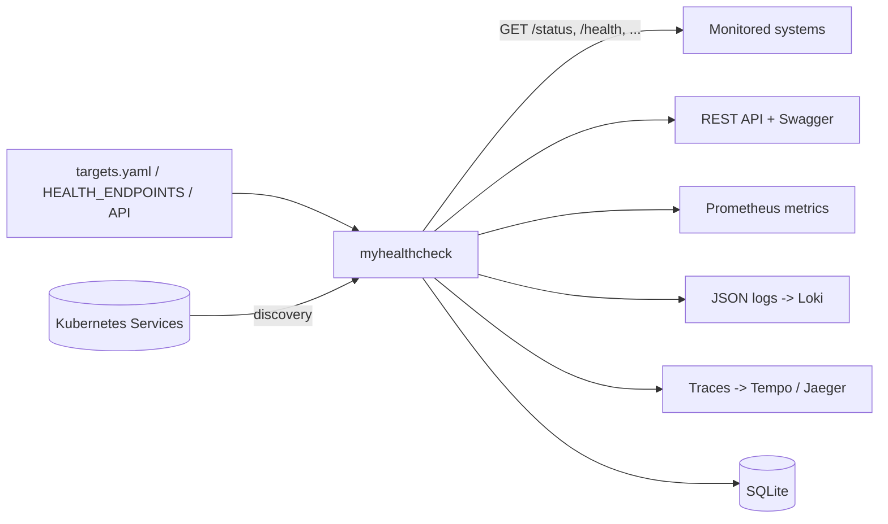

# myhealthcheck

<!-- TOC -->

- [About](#about)
- [Features](#features)
- [Quick start](#quick-start)
- [How to use](#how-to-use)
  - [Docker Compose (app + observability stack)](#docker-compose-app--observability-stack)
  - [Python](#python)
  - [Kubernetes (Helm 4)](#kubernetes-helm-4)
- [Configuration in 30 seconds](#configuration-in-30-seconds)
- [Make targets](#make-targets)
- [Documentation](#documentation)
- [License](#license)

<!-- TOC -->

# About

``myhealthcheck`` is a health check system developed in [Python](https://www.python.org) that
monitors the availability of other applications. It reads the systems to check from a list
(file, environment variable or API) and/or discovers them automatically in Kubernetes, probes
default or custom health paths, stores the results in SQLite and exposes everything through a
REST API (Swagger/OpenAPI), Prometheus metrics, JSON logs and OpenTelemetry traces.



# Features

* **Static targets** from YAML/JSON/text files or `HEALTH_ENDPOINTS`, in the forms
  `protocol://host:port/endpoint`, `protocol:host:port/endpoint` or `host:port`.
* **Default health paths** (`/status`, `/health`, `/healthz`, `/livez`, `/readyz`, `/ready`, `/ping`,
  `/-/healthy`, `/actuator/health`, ...) probed in order, or **custom paths** per target.
* **Kubernetes discovery** of Services in a list of namespaces, in all namespaces, or all
  except an exclusion list (globs supported), on ports **80, 8080, 8888** by default (customizable),
  with per-service annotations.
* Checks every **60 s** by default (`CHECK_INTERVAL`), with timeouts, smart retries
  (network errors/5xx only), expected status codes/body and a slow-response threshold.
* **REST API** documented with **Swagger/OpenAPI**: list systems, endpoints and status, register,
  remove, check now, ad-hoc probe, run discovery, history, summary.
* **SQLite storage** with fallback: `DB_PATH` -> temp directory -> memory.
* **Observability**: Prometheus metrics, JSON logs with `trace_id`, OpenTelemetry traces,
  Grafana dashboard (metrics + logs + traces) and a Docker Compose stack with Grafana, Loki,
  Tempo, Prometheus, Jaeger and Alloy.
* **Alerts** on status change (JSON log + optional webhook) and Prometheus alert rules.
* **Helm 4 chart** with least-privilege RBAC, HTTP probes, non-root read-only container,
  ServiceMonitor, PrometheusRule and dashboard ConfigMap.
* `--once` mode for CI/cron (exit code 1 when something is down).

# Quick start

```bash
git clone https://github.com/aeciopires/myhealthcheck.git
cd myhealthcheck
make install-deps     # everything except Docker (see REQUIREMENTS.md)
make up               # app + Grafana/Loki/Tempo/Prometheus/Jaeger/Alloy
```

Open http://localhost:8000/docs (API) and http://localhost:3000 (Grafana, dashboard *myhealthcheck*).

# How to use

## Docker Compose (app + observability stack)

```bash
make up                         # build and start
make logs ARGS=myhealthcheck    # JSON logs of the app
make down                       # stop (ARGS=-v also removes the volumes)
```

Targets are in [config/targets.yaml](config/targets.yaml). Host ports can be changed with
variables, e.g. `GRAFANA_PORT=3300 make up` (see the header of [docker-compose.yml](docker-compose.yml)).

## Python

```bash
make sync                                         # create .venv
make run ARGS="-t config/targets.yaml"            # API on :8000 + checks every 60 s
make run-once ARGS="-u https://example.com"       # one cycle, JSON report, exit code
uv run myhealthcheck --help
```

## Kubernetes (Helm 4)

```bash
helm upgrade --install myhealthcheck charts/myhealthcheck -n myhealthcheck --create-namespace \
  --set 'config.discovery.namespaces={shop,payments}'
make kind-deploy                                  # or: local kind cluster in one command
```

See the [chart README](charts/myhealthcheck/README.md) for every value.

# Configuration in 30 seconds

| I want to... | Set |
|---|---|
| check a list of URLs | `HEALTH_ENDPOINTS=http://a:8080/health,https:b:443/status` |
| use a file | `TARGETS_FILE=config/targets.yaml` |
| change the interval | `CHECK_INTERVAL=30` |
| change the default paths | `DEFAULT_HEALTH_PATHS=/status,/health,/ping` |
| discover in Kubernetes | `DISCOVERY_ENABLED=true` |
| ...only some namespaces | `DISCOVERY_NAMESPACES=shop,team-*` |
| ...all but some | `DISCOVERY_EXCLUDE_NAMESPACES=kube-system,*-dev` |
| ...other ports | `DISCOVERY_PORTS=80,3000` or `*` |
| export traces | `OTEL_ENABLED=true OTEL_EXPORTER_OTLP_ENDPOINT=http://alloy:4318` |
| receive alerts | `ALERT_WEBHOOK_URL=https://...` |

Full reference: [docs/configuration.md](docs/configuration.md).

# Make targets

```bash
make help            # list everything
make check-deps      # check required software
make install-deps    # install mise, pinned tools and the Python venv (not Docker)
make lint test       # ruff, mypy, shellcheck, hadolint, yamllint, helm lint + tests (>= 90% coverage)
make image scan      # build the image and scan it with Trivy
make helm-docs       # regenerate the chart README
make dashboard       # regenerate the Grafana dashboard
make openapi         # export docs/openapi.json
```

# Documentation

* [REQUIREMENTS.md](REQUIREMENTS.md) - supported platforms and installation.
* [docs/](docs/README.md) - beginner friendly guides: architecture, configuration, discovery,
  API, storage, observability, development and troubleshooting.
* [charts/myhealthcheck/README.md](charts/myhealthcheck/README.md) - Helm chart.
* [CHANGELOG.md](CHANGELOG.md) - release notes.
* [CLAUDE.md](CLAUDE.md) - maintenance notes for AI assistants and humans.

# License

[GPL-3.0](LICENSE).
