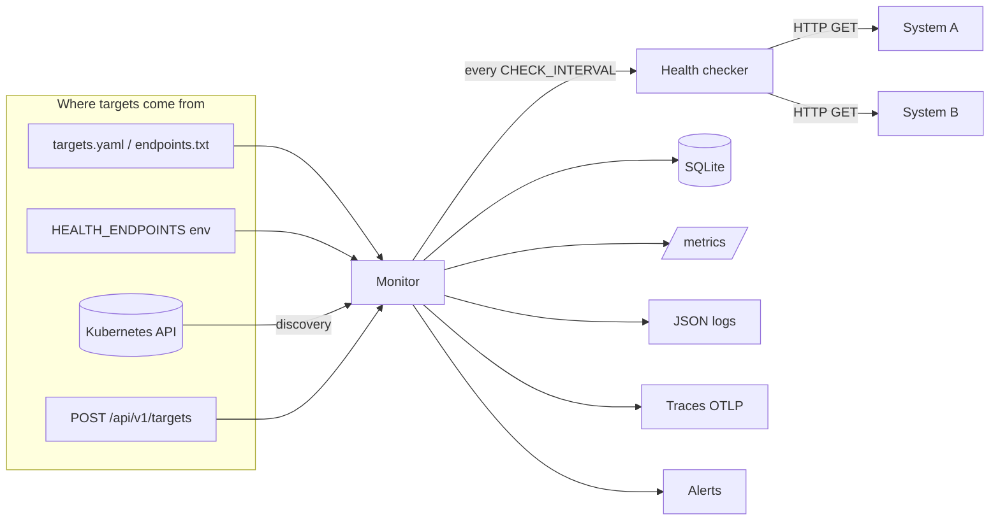

# myhealthcheck documentation

Welcome! These pages explain **what** myhealthcheck does, **how** it is built and
**how to maintain it**, assuming no previous knowledge of the code.

## The big picture in one analogy

Think of myhealthcheck as a **hospital ward**:

| Hospital | myhealthcheck |
|---|---|
| Patients | Monitored systems (*targets*) |
| Census taker who finds new patients | Kubernetes discovery |
| Nurse doing rounds every hour | Health checker running every `CHECK_INTERVAL` seconds |
| Measuring the pulse on one or more spots | Calling health paths such as `/status`, `/health` |
| Medical records cabinet | SQLite database |
| Board in the hallway | Prometheus metrics and Grafana dashboard |
| Pager that beeps when a patient gets worse/better | Alerts on status change (log + webhook) |
| Reception desk | REST API with Swagger UI |

## Reading order

1. [getting-started.md](getting-started.md) - run it in 5 minutes.
2. [architecture.md](architecture.md) - modules, data flow and decisions.
3. [configuration.md](configuration.md) - every option (env, CLI, targets file).
4. [kubernetes-discovery.md](kubernetes-discovery.md) - namespaces, ports, annotations, RBAC.
5. [api.md](api.md) - REST API and Swagger/OpenAPI.
6. [storage.md](storage.md) - SQLite and the fallback chain.
7. [observability.md](observability.md) - metrics, JSON logs, traces, Grafana.
8. [development.md](development.md) - how to change the code safely.
9. [troubleshooting.md](troubleshooting.md) - common problems.

Also see: [../README.md](../README.md), [../REQUIREMENTS.md](../REQUIREMENTS.md),
[Helm chart](../charts/myhealthcheck/README.md) and [../CHANGELOG.md](../CHANGELOG.md).
