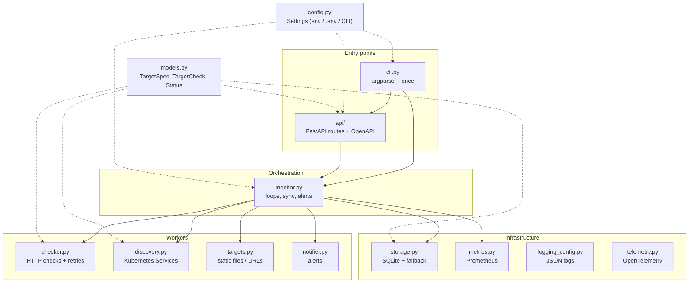
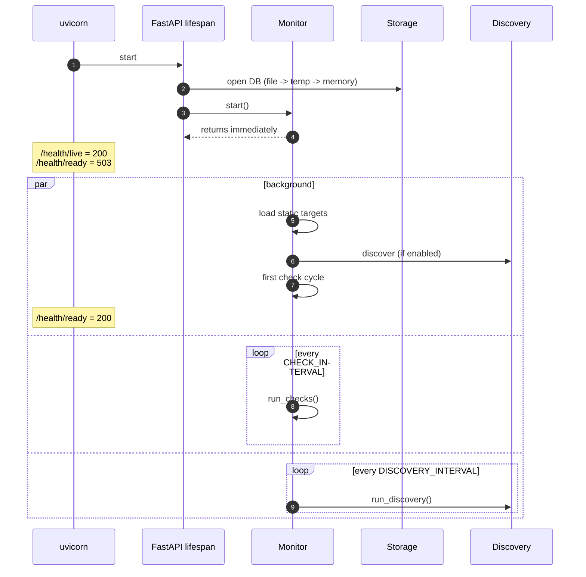
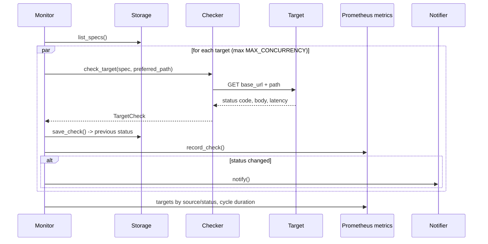
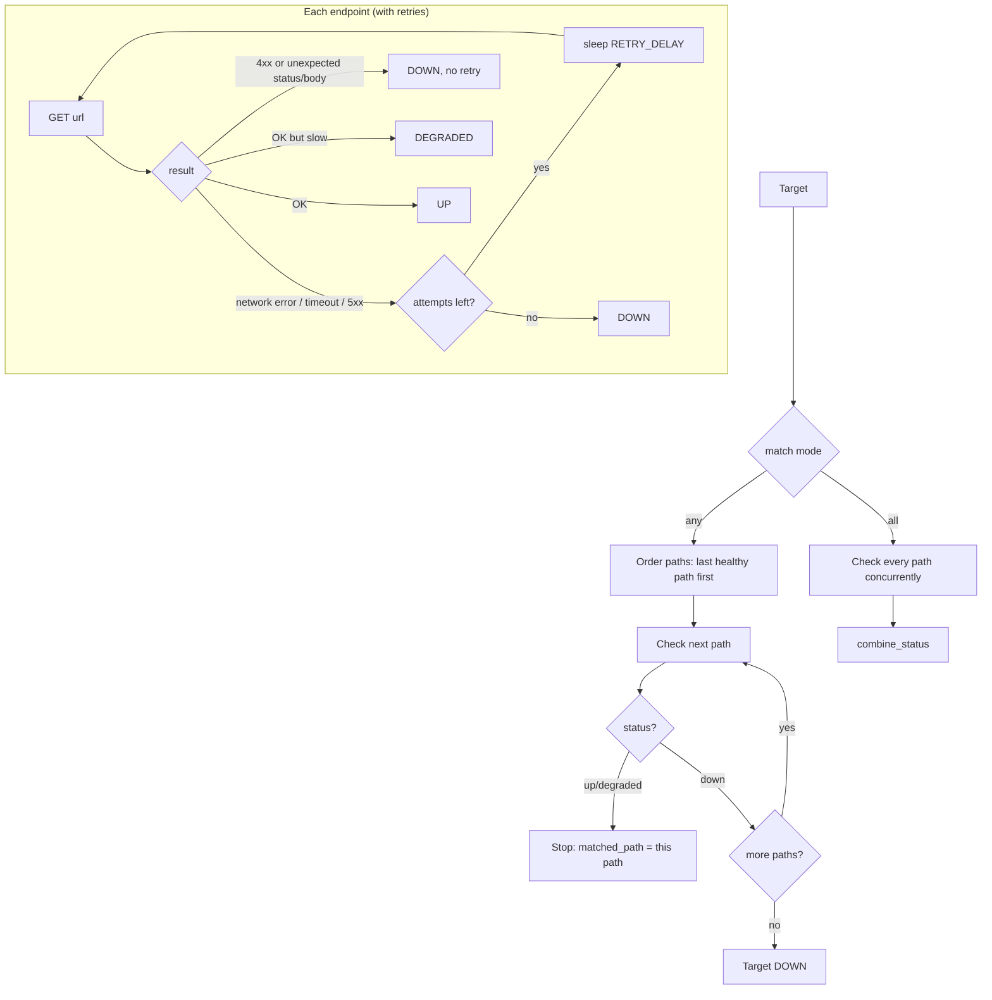
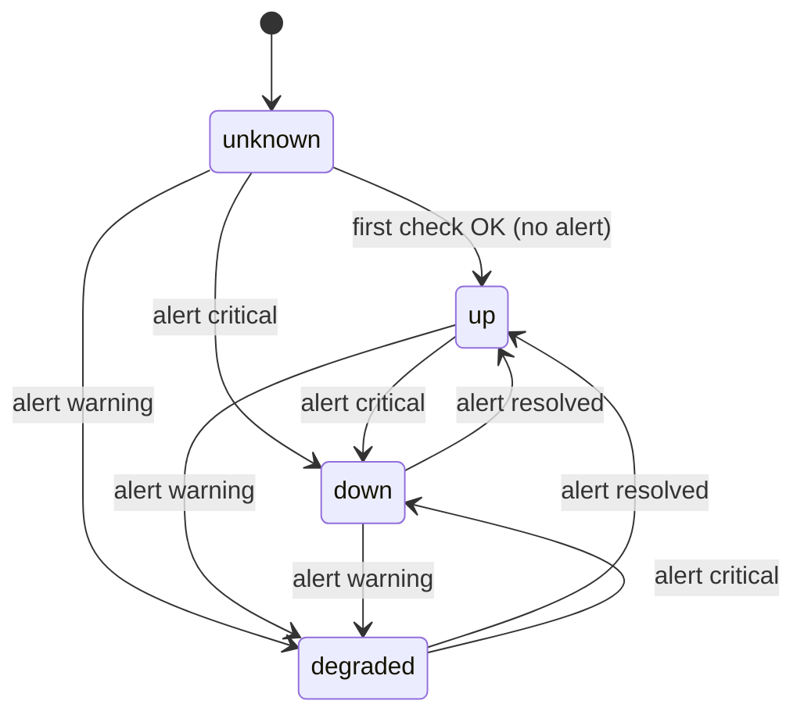

# Architecture

<!-- TOC -->

- [Layers](#layers)
- [Modules](#modules)
- [Startup sequence](#startup-sequence)
- [One check cycle](#one-check-cycle)
- [How a target is checked](#how-a-target-is-checked)
- [Status model](#status-model)
- [Design decisions](#design-decisions)

<!-- TOC -->

## Layers

Analogy: a **restaurant**. The *waiters* (API) take orders, the *kitchen manager*
(Monitor) organizes the work, the *cooks* (checker, discovery) do the actual work and
the *pantry* (storage) keeps everything. Waiters never cook, cooks never talk to clients.

## Modules

| Module | Responsibility | Analogy |
|---|---|---|
| `config.py` | Pydantic `Settings`; env vars, `.env`, legacy aliases | The house rules |
| `models.py` | `TargetSpec` (what to check), `EndpointResult`, `TargetCheck`, `TargetState`, `Status` | The forms everybody fills |
| `targets.py` | Parse `targets.yaml/.json/.txt`, `HEALTH_ENDPOINTS`, URL normalization | The appointment book |
| `discovery.py` | List Services in namespaces, filter ports, read annotations | The census taker |
| `checker.py` | HTTP GET with timeout, retries, body/status validation, path probing | The nurse |
| `storage.py` | SQLite tables `targets` and `check_history`, fallback file -> temp -> memory | The records cabinet |
| `monitor.py` | Glue: loads targets, runs loops, records results, triggers alerts | The head nurse |
| `notifier.py` | Alert only on status **change** (log + optional webhook) | The pager |
| `metrics.py` | Prometheus metrics with their own registry | The hallway board |
| `logging_config.py` | One JSON object per log line with `trace_id`/`span_id` | The diary |
| `telemetry.py` | OpenTelemetry tracer, FastAPI/httpx instrumentation | The GPS tracker |
| `api/` | FastAPI app factory, routes, schemas | The reception desk |
| `cli.py` | Command line, `--once` mode, starts uvicorn | The front door |

## Startup sequence

The server answers liveness immediately; readiness only turns green after the first
cycle. This prevents Kubernetes from killing a pod that is still doing its first
(possibly slow) round.

## One check cycle

## How a target is checked

Why no retry on `404`? Retrying cannot fix "this path does not exist"; it only wastes
time while probing the default paths. Analogy: if a door does not exist, knocking
three times won't create it.

## Status model

| Status | Meaning |
|---|---|
| `unknown` | Never checked yet |
| `up` | Expected status code (and body, if configured) within the threshold |
| `degraded` | Correct answer but slower than `RESPONSE_TIME_THRESHOLD`, or (mode `all`) only some paths healthy |
| `down` | Network error, timeout, unexpected status or body |

## Design decisions

* **asyncio + httpx**: one process checks thousands of endpoints concurrently with little memory.
* **Kubernetes client is synchronous** and runs in `asyncio.to_thread` to avoid blocking the loop.
* **SQLite** (stdlib) keeps state and history without an external database; access is serialized
  by a lock and executed in threads.
* **Composition root** (`api/app.py::build_monitor`): objects receive their dependencies, which
  makes unit tests easy (fake transports, fake Kubernetes API).
* **Metrics registry per app**: no global state, tests do not interfere with each other.
* **Alerts on transitions only**: avoids alert storms.
* **Stable target ids** (`<source>-<namespace>-<name>`) so history survives restarts.
