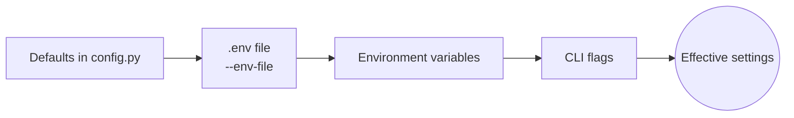

# Configuration

<!-- TOC -->

- [Precedence](#precedence)
- [Environment variables](#environment-variables)
- [Command line](#command-line)
- [Endpoint formats](#endpoint-formats)
- [Targets file](#targets-file)
- [Default health paths](#default-health-paths)
- [Migrating from 2.x](#migrating-from-2x)

<!-- TOC -->

## Precedence

Analogy: like clothes on a cold day - the outer layer is what people see.



The effective settings are logged at startup and available at `GET /api/v1/config`
(secrets masked). Lists are **comma separated** (`a,b,c`).

## Environment variables

| Variable | Default | Description |
|---|---|---|
| `HTTP_HOST` | `0.0.0.0` | Bind address of the API |
| `HTTP_PORT` (`OUTPUT_PORT`) | `8000` | API port |
| `LOG_LEVEL` | `INFO` | `DEBUG`, `INFO`, `WARNING`, `ERROR`, `CRITICAL` (logs are always JSON) |
| `CHECK_INTERVAL` | `60` | Seconds between check cycles |
| `REQUEST_TIMEOUT` | `5` | Per-request timeout (s) |
| `RESPONSE_TIME_THRESHOLD` | `3.0` | Slower answers are `degraded` |
| `RETRY_ATTEMPTS` | `3` | Attempts per endpoint (only network errors, timeouts, 5xx are retried) |
| `RETRY_DELAY` | `2` | Seconds between retries |
| `MAX_CONCURRENCY` | `50` | Targets checked at the same time |
| `VERIFY_TLS` | `true` | Verify certificates of `https` targets |
| `DEFAULT_HEALTH_PATHS` | see below | Paths probed when a target has none |
| `EXPECTED_STATUS_CODES` | *(any 2xx/3xx)* | Global accepted status codes |
| `HEALTH_ENDPOINTS` | | Comma separated list of endpoints (see formats) |
| `TARGETS_FILE` (`ENDPOINTS_FILE`) | | YAML/JSON/text file with targets |
| `DISCOVERY_ENABLED` (`USE_K8S_DISCOVERY`, `USE_K8S_DISCOVERY_ON_POD`) | `false` | Kubernetes discovery |
| `DISCOVERY_NAMESPACES` (`K8S_NAMESPACE`) | *(all)* | Namespaces to scan, globs allowed |
| `DISCOVERY_EXCLUDE_NAMESPACES` | `kube-system,kube-public,kube-node-lease` | Namespaces to skip, globs allowed |
| `DISCOVERY_PORTS` | `80,8080,8888` | Service ports to check; `*` = all TCP ports |
| `DISCOVERY_LABEL_SELECTOR` (`K8S_LABEL_SELECTOR`) | | Label selector for Services |
| `DISCOVERY_REQUIRE_ANNOTATION` | `false` | Only Services annotated `myhealthcheck.io/enabled: "true"` |
| `DISCOVERY_INTERVAL` | `300` | Seconds between discovery runs |
| `DISCOVERY_SCHEME` | `http` | Scheme for discovered Services |
| `DISCOVERY_SERVICE_DOMAIN` | `svc` | DNS suffix: `<svc>.<ns>.<domain>` |
| `K8S_CONTEXT` (`K8S_CLUSTER_NAME`) | *(current)* | kubeconfig context (outside the cluster) |
| `K8S_IN_CLUSTER` | *(auto)* | Force (`true`) or skip (`false`) in-cluster config |
| `DB_PATH` | `data/myhealthcheck.db` | SQLite file (see [storage.md](storage.md)) |
| `HISTORY_RETENTION` | `100` | History rows kept per target |
| `OTEL_ENABLED` | `false` | Export traces via OTLP/HTTP |
| `OTEL_SERVICE_NAME` | `myhealthcheck` | `service.name` of spans |
| `OTEL_EXPORTER_OTLP_ENDPOINT` | | Standard OpenTelemetry variable, e.g. `http://alloy:4318` |
| `ALERT_WEBHOOK_URL` | | JSON POST on every status change |

Names in parentheses are the **legacy names** from 2.x, still accepted.

A commented example lives in [config/env.example](../config/env.example).

## Command line

```text
myhealthcheck [-f ENV_FILE] [-t TARGETS_FILE] [-u URL ...] [--paths P1,P2] [-i SECONDS]
              [-o PORT] [--host HOST] [--db-path FILE] [--log-level LEVEL]
              [-d] [-p] [-n NS1,NS2] [-x NS1,NS2] [-l SELECTOR] [--ports 80,8080] [-k CONTEXT]
              [--once] [-V]
```

| Flag | Same as |
|---|---|
| `-f, --env-file` | load a `.env` file |
| `-t, -e, --targets-file` | `TARGETS_FILE` |
| `-u, --url` (repeatable) | `HEALTH_ENDPOINTS` |
| `--paths` | `DEFAULT_HEALTH_PATHS` |
| `-i, --interval` | `CHECK_INTERVAL` |
| `-o, --port` / `--host` | `HTTP_PORT` / `HTTP_HOST` |
| `--db-path` | `DB_PATH` |
| `-d, --discovery` | `DISCOVERY_ENABLED=true` |
| `-p, --in-cluster` | discovery with the in-cluster service account |
| `-n, --namespaces` / `-x, --exclude-namespaces` | `DISCOVERY_NAMESPACES` / `DISCOVERY_EXCLUDE_NAMESPACES` |
| `-l, --label-selector` | `DISCOVERY_LABEL_SELECTOR` |
| `--ports` | `DISCOVERY_PORTS` |
| `-k, --context` | `K8S_CONTEXT` |
| `--once` | run one cycle, print JSON, exit `0` (ok) / `1` (something down) / `2` (bad config) |

## Endpoint formats

Anywhere an endpoint is accepted (`HEALTH_ENDPOINTS`, `-u`, text file, `url:` in YAML, API):

| Input | Interpreted as |
|---|---|
| `http://10.0.0.5:8080/status` | standard URL |
| `https:api.example.com:8443/health` | short form `protocol:host:port/endpoint` |
| `my-svc:8080/health` | `http://my-svc:8080/health` |
| `http://my-svc:8080` | no path: **default health paths** are probed |

Rules for `url` + `paths` (in YAML and in the API):

* without `paths`, the URL path **is** the health path: `http://a/health` -> `http://a` + `/health`;
* with `paths`, the URL path is a **prefix**: `http://a/api` + `[/health]` -> `http://a/api/health`.

## Targets file

`.yaml`/`.yml`/`.json` are structured; any other extension is plain text (one endpoint per line,
`#` comments). Example: [config/targets.yaml](../config/targets.yaml).

```yaml
defaults:            # merged into every target
  timeout: 5
targets:
  - name: payments
    url: http://payments:8080
    paths: [/live, /ready]
    match: all               # any (default) | all
    expected_status: [200]   # default: any 2xx/3xx
    expected_body: '"status":"UP"'
    labels: {team: billing}
  - http://legacy:9000/status   # plain string is fine too
```

Static targets are synchronized at every start: removing a target from the file removes it
(and its history) from the database.

## Default health paths

Probed in this order (mode `any` stops at the first healthy answer; the next cycle starts with
the path that worked last time):

```text
/status /health /healthz /livez /readyz /ready /ping /-/healthy /-/ready /api/health
/health/live /health/ready /actuator/health /q/health /_health /healthcheck
```

Override with `DEFAULT_HEALTH_PATHS` or `--paths`.

## Migrating from 2.x

| 2.x | 3.x |
|---|---|
| `python main.py` | `myhealthcheck` (or `python -m myhealthcheck`) |
| `-e endpoints.txt` | still works (`-t` is the new name), YAML recommended |
| `-p` (discovery on pod) | still works (`--in-cluster`) |
| `-o PORT` | still works |
| `-k CLUSTER_NAME` (validated against the context) | `-k CONTEXT` selects the kubeconfig context |
| Checks `/health` and `/status` on every service port | Default paths list + `DISCOVERY_PORTS` filter + annotations |
| Body must contain `{"message": "It's working"}` | Optional `expected_body` per target |
| Plain text logs | JSON logs |
