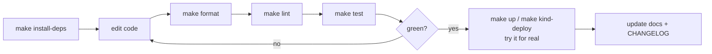

# Development and maintenance

<!-- TOC -->

- [Repository layout](#repository-layout)
- [Daily workflow](#daily-workflow)
- [Coding guidelines](#coding-guidelines)
- [Tests](#tests)
- [Common changes (recipes)](#common-changes-recipes)
- [Updating versions](#updating-versions)
- [Releasing](#releasing)
- [Code analysis with SonarQube](#code-analysis-with-sonarqube)

<!-- TOC -->

## Repository layout

```text
src/myhealthcheck/       application package (see architecture.md)
  api/                   FastAPI app, routes, schemas
tests/                   pytest unit tests (coverage >= 90%)
config/                  example targets and env files
charts/myhealthcheck/    Helm 4 chart (+ dashboards/ used by compose too)
observability/           Alloy, Loki, Tempo, Prometheus, Grafana configs for compose
scripts/                 check/install deps, dashboard generator
docs/                    this documentation
mise.toml                pinned tool versions
pyproject.toml, uv.lock  Python project and locked dependencies
```

## Daily workflow



## Coding guidelines

* Python 3.13+ syntax (`X | None`, `StrEnum`, `match`, PEP 695 when useful); `from __future__ import annotations`.
* Type hints everywhere; `mypy --strict` must pass.
* `ruff` is the formatter and linter (line length 100).
* Configuration only through `config.Settings`; never read `os.environ` elsewhere.
* No global state: dependencies are passed in (see `api/app.py::build_monitor`).
* Blocking calls (SQLite, Kubernetes client) run in `asyncio.to_thread`.
* Log with `logger.info("short message", extra={...})` - the extras become JSON fields. Do not use
  the reserved `LogRecord` names (`name`, `message`, `args`, ...) as keys.
* New metrics go to `metrics.py` with a `myhealthcheck_` prefix; remember `forget_target`
  for per-target series.

## Tests

```bash
make test                                   # all tests + coverage (fails < 90%)
uv run pytest tests/test_checker.py -k retry -vv
make coverage                               # HTML report in htmlcov/
```

Test helpers in `tests/conftest.py`:

* `routes_transport({url: 200 | Response | Exception | callable})` - fake HTTP server for httpx.
* `FakeCoreV1Api` and `k8s_service(...)` - fake Kubernetes API.
* `settings` / `storage` fixtures with a temporary database and no retry delay.

No test touches the network or a real cluster.

## Common changes (recipes)

**Add a default health path**: edit `DEFAULT_HEALTH_PATHS` in `config.py`, update
`config/env.example`, `docs/configuration.md` and the test in `tests/test_config.py`.

**Add a setting**: add a `Field` to `Settings` (with `validation_alias`), use it, document it in
`docs/configuration.md`, `config/env.example`, chart `values.yaml` + `templates/configmap.yaml`,
then `make helm-docs`.

**Add an API endpoint**: route in `api/routes.py` with `response_model`, `summary`, `tags`;
schema in `api/schemas.py`; test in `tests/test_api.py`; update `docs/api.md` and `make openapi`.

**Add a Service annotation**: `discovery.py::_targets_for_service`, test in
`tests/test_discovery.py`, docs in `docs/kubernetes-discovery.md` and the chart README template.

**Change the dashboard**: edit `scripts/gen_dashboard.py`, run `make dashboard`, check it with `make up`.

## Updating versions

| What | Where |
|---|---|
| CLI tools (python, uv, helm, kubectl, kind, linters) | `mise.toml` (+ `.python-version`) |
| Python libraries | `pyproject.toml`, then `uv lock --upgrade` |
| Base image and uv image | `Dockerfile` |
| Observability images | `docker-compose.yml`, table in `docs/observability.md` |
| App version | `pyproject.toml`, `Dockerfile` `ARG VERSION`, `docker-compose.yml`, chart `appVersion` |
| Chart version | `charts/myhealthcheck/Chart.yaml` `version` |

Find the latest versions with `mise ls-remote <tool>` and `uv lock --upgrade --dry-run`.
After updating: `make lint test up` and check the dashboard queries still return data.

## Releasing

1. Update versions (table above) and `CHANGELOG.md`.
2. `make lint test helm-docs openapi`.
3. `make image-multiarch` (after `docker login`) and `make scan`.
4. `make helm-package` and publish the chart.
5. Tag the commit: `git tag v<version>`.

## Code analysis with SonarQube

```bash
docker run -d --name sonarqube -p 9000:9000 sonarqube:community
make test                                   # produces coverage.xml
docker run --rm --network host -e SONAR_HOST_URL=http://localhost:9000 \
  -e SONAR_TOKEN=<token> -v "$PWD:/usr/src" sonarsource/sonar-scanner-cli
```

Settings are in [sonar-project.properties](../sonar-project.properties). Never commit tokens.
