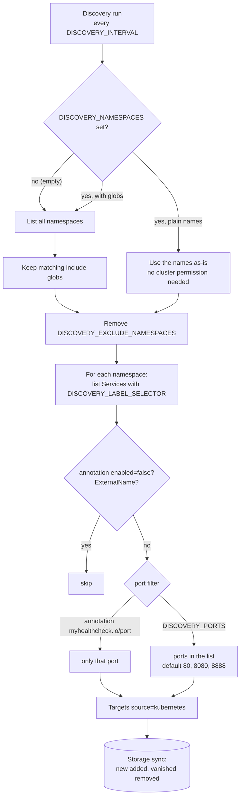
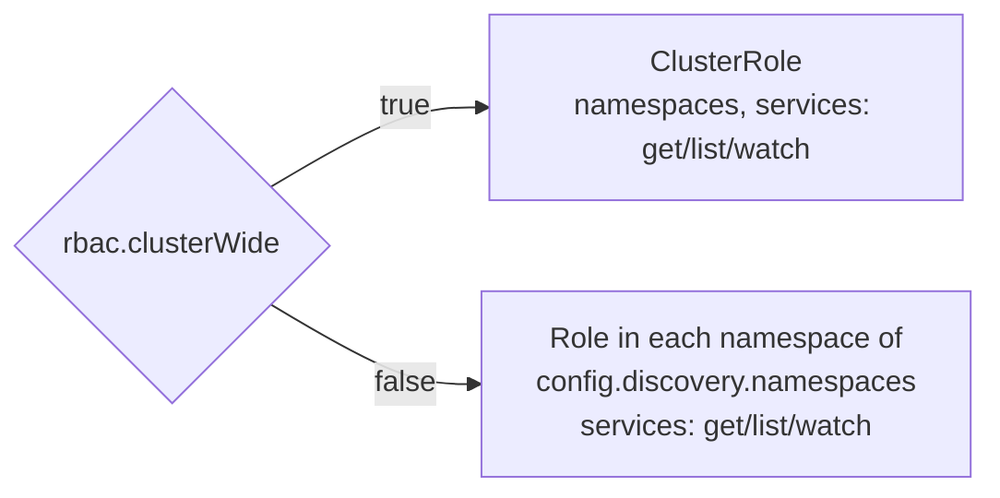

# Kubernetes discovery

<!-- TOC -->

- [How it works](#how-it-works)
- [Choosing namespaces](#choosing-namespaces)
- [Choosing ports](#choosing-ports)
- [Annotations](#annotations)
- [RBAC](#rbac)
- [Running outside the cluster](#running-outside-the-cluster)

<!-- TOC -->

## How it works

Analogy: a **census taker** visits neighbourhoods (namespaces), knocks on every house
(Service) and writes down the doors (ports) that match the list. Each door becomes a
target `http://<service>.<namespace>.svc:<port>` whose health paths are probed.



Discovered targets are re-synchronized on every run: a deleted Service disappears from
the API, metrics and database automatically.

## Choosing namespaces

| Goal | Setting |
|---|---|
| Every namespace (default) | `DISCOVERY_NAMESPACES=` (empty) |
| A fixed list | `DISCOVERY_NAMESPACES=shop,payments` |
| A pattern | `DISCOVERY_NAMESPACES=team-*` |
| Everything except some | `DISCOVERY_EXCLUDE_NAMESPACES=kube-system,kube-public,kube-node-lease,*-dev` |

Exclusions are always applied, also on top of an explicit list. Patterns use shell globs
(`*`, `?`, `[abc]`).

## Choosing ports

By default only Service ports **80, 8080 and 8888** are checked (`DISCOVERY_PORTS`).
Use `DISCOVERY_PORTS=*` for every TCP port, or a custom list (`80,3000,9000`).
A Service can opt in to any port with the annotation `myhealthcheck.io/port`.

## Annotations

```yaml
apiVersion: v1
kind: Service
metadata:
  name: payments
  annotations:
    myhealthcheck.io/port: "http"            # name or number; wins over DISCOVERY_PORTS
    myhealthcheck.io/paths: "/livez,/readyz" # instead of the default paths
    myhealthcheck.io/match: "all"            # both paths must answer
    myhealthcheck.io/scheme: "https"
    myhealthcheck.io/expected-status: "200"
    myhealthcheck.io/expected-body: "ok"
    # myhealthcheck.io/enabled: "false"      # skip this service
```

With `DISCOVERY_REQUIRE_ANNOTATION=true` the logic is reversed (opt-in): only Services with
`myhealthcheck.io/enabled: "true"` are checked.

## RBAC

Discovery only **reads** Services (and Namespaces when it must list them).



* `rbac.clusterWide=true` (default) is required to scan all namespaces or to use globs.
* `rbac.clusterWide=false` creates one Role/RoleBinding per listed namespace (least privilege).
  The chart refuses to render if the list is empty or contains globs.

## Running outside the cluster

```bash
uv run myhealthcheck -d -k kind-myhealthcheck -n default,apps --once
```

The kubeconfig context is used, but the generated URLs (`*.svc`) only resolve **inside**
the cluster. Outside it, use this mode to test discovery itself (the targets will be `down`)
or run `kubectl port-forward`/a VPN that resolves cluster DNS.
