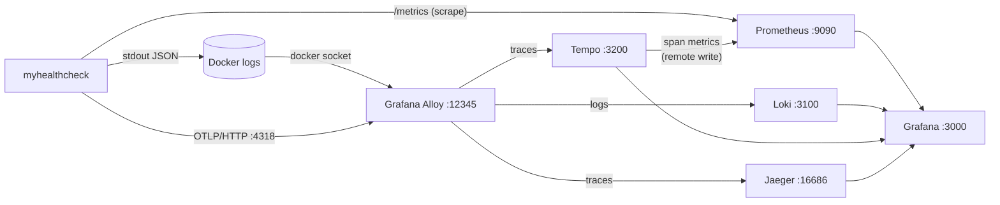

# Observability: metrics, logs and traces

<!-- TOC -->

- [The three signals](#the-three-signals)
- [Local stack (docker compose)](#local-stack-docker-compose)
- [Metrics](#metrics)
- [JSON logs](#json-logs)
- [Traces](#traces)
- [Grafana dashboard](#grafana-dashboard)
- [Kubernetes](#kubernetes)

<!-- TOC -->

## The three signals

Analogy: a **car**.

* **Metrics** are the dashboard gauges (speed, fuel): numbers over time, cheap, great for alerts.
* **Logs** are the trip diary: what happened, with details.
* **Traces** are the GPS route: the path of one request through every step and how long each took.

The `trace_id` written in every log line is the link between the diary and the GPS.

## Local stack (docker compose)



| Component | Version | Config |
|---|---|---|
| Grafana | 13.3.1 | [observability/grafana/provisioning](../observability/grafana/provisioning) |
| Prometheus | 3.16.0 | [observability/prometheus](../observability/prometheus) (+ alert rules) |
| Loki | 3.7.10 | [observability/loki/loki.yaml](../observability/loki/loki.yaml) |
| Tempo | 3.1.1 | [observability/tempo/tempo.yaml](../observability/tempo/tempo.yaml) |
| Jaeger | 2.23.0 | defaults (in-memory) |
| Grafana Alloy | 1.22.0 | [observability/alloy/config.alloy](../observability/alloy/config.alloy) |

Alloy replaces Promtail (end of life) for logs and acts as the OpenTelemetry collector that
fans traces out to both Tempo and Jaeger. It only collects logs from containers of the compose
project `myhealthcheck`.

Grafana datasources are linked: Loki `trace_id` -> Tempo, Tempo -> Loki logs of the trace,
Tempo -> Prometheus span metrics, Prometheus exemplars -> Tempo.

## Metrics

| Metric | Type | Labels | Meaning |
|---|---|---|---|
| `myhealthcheck_target_up` | gauge | target, name, namespace, source | 1 = up/degraded, 0 = down |
| `myhealthcheck_target_status` | gauge | ... + status | one-hot current status |
| `myhealthcheck_target_response_seconds` | gauge | target, name, namespace, source | latency of the last check |
| `myhealthcheck_check_duration_seconds` | histogram | target, source | latency distribution |
| `myhealthcheck_checks_total` | counter | target, source, status | checks by result |
| `myhealthcheck_targets` | gauge | source, status | number of targets |
| `myhealthcheck_check_cycle_duration_seconds` | histogram | | duration of a full cycle |
| `myhealthcheck_last_check_cycle_timestamp_seconds` | gauge | | unix time of the last cycle |
| `myhealthcheck_discovery_runs_total` | counter | result | discovery runs (success/error) |
| `myhealthcheck_discovered_targets` | gauge | | targets found by the last discovery |
| `myhealthcheck_alerts_total` | counter | severity | status-change alerts |
| `myhealthcheck_http_requests_total` | counter | method, route, status_code | API requests |
| `myhealthcheck_http_request_duration_seconds` | histogram | method, route | API latency |
| `myhealthcheck_storage_backend` | gauge | backend | 1 for the active backend |
| `myhealthcheck_build_info` | info | version | build information |

Series of removed targets are deleted, so dashboards do not show ghosts.
Example alert rules: [observability/prometheus/alerts.yaml](../observability/prometheus/alerts.yaml)
(also available in the chart with `prometheusRule.enabled=true`).

## JSON logs

Every line is one JSON object:

```json
{"timestamp": "2026-11-16T10:23:59.521+00:00", "level": "info", "logger": "myhealthcheck.monitor",
 "message": "target checked", "service": "myhealthcheck",
 "trace_id": "b55811c36157b8bab278c4c2248cab58", "span_id": "0a9082df2e674a1b",
 "event": "check", "target": "static-kube-pires", "target_name": "kube-pires",
 "namespace": null, "source": "static", "status": "up", "matched_path": "/readyz",
 "response_time": 0.0042, "endpoints": [{"url": "...", "status": "up", "status_code": 200}]}
```

Useful `event` values: `check`, `cycle`, `alert`, `http_request`.

LogQL examples:

```logql
{service_name="myhealthcheck"} | json | event="alert"
{service_name="myhealthcheck"} | json | event="check" | status="down"
sum by (target) (count_over_time({service_name="myhealthcheck"} | json | status="down" [1h]))
```

## Traces

Enable with `OTEL_ENABLED=true` and `OTEL_EXPORTER_OTLP_ENDPOINT` (OTLP/HTTP, e.g.
`http://alloy:4318`). Every standard `OTEL_*` variable of the OpenTelemetry SDK works.

Spans: `check_cycle` -> `check_target` -> `check_endpoint` -> `GET` (httpx), plus
`kubernetes_discovery` and one server span per API request (health/metrics endpoints are excluded).
Attributes: `myhealthcheck.target`, `myhealthcheck.status`, `url.full`, `http.response.status_code`.

TraceQL examples:

```traceql
{resource.service.name="myhealthcheck" && span.myhealthcheck.status="down"}
{resource.service.name="myhealthcheck" && name="check_cycle" && duration > 5s}
```

## Grafana dashboard

[charts/myhealthcheck/dashboards/myhealthcheck.json](../charts/myhealthcheck/dashboards/myhealthcheck.json)
is generated by [scripts/gen_dashboard.py](../scripts/gen_dashboard.py) (`make dashboard`) and
used by both docker compose and the Helm chart. Rows:

1. **Overview** - totals by status, time since the last cycle, storage backend.
2. **Targets** - status table, availability timeline, response time, p95 latency, checks, alerts.
3. **Kubernetes discovery & API** - discovered targets, discovery runs, API traffic.
4. **Logs (Loki)** - log volume by level, alert log, full log with search.
5. **Traces (Tempo)** - recent traces, slow/failed spans, span metrics.

Variables: datasources (`DS_PROMETHEUS`, `DS_LOKI`, `DS_TEMPO`), `namespace`, `source`, `target`,
`service` (log/trace service name), `level` and `search`.

## Kubernetes

* Metrics: `serviceMonitor.enabled=true` (Prometheus Operator) or scrape the Service on `/metrics`.
* Logs: any agent that ships pod logs to Loki (Alloy, Promtail, Fluent Bit). With the
  `app.kubernetes.io/name` label Loki sets `service_name=myhealthcheck`.
* Traces: `config.tracing.enabled=true`, `config.tracing.endpoint=http://<collector>:4318`.
* Dashboard: `grafanaDashboard.enabled=true` (ConfigMap for the Grafana sidecar).
