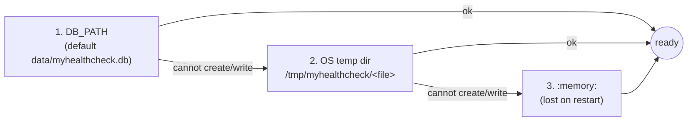
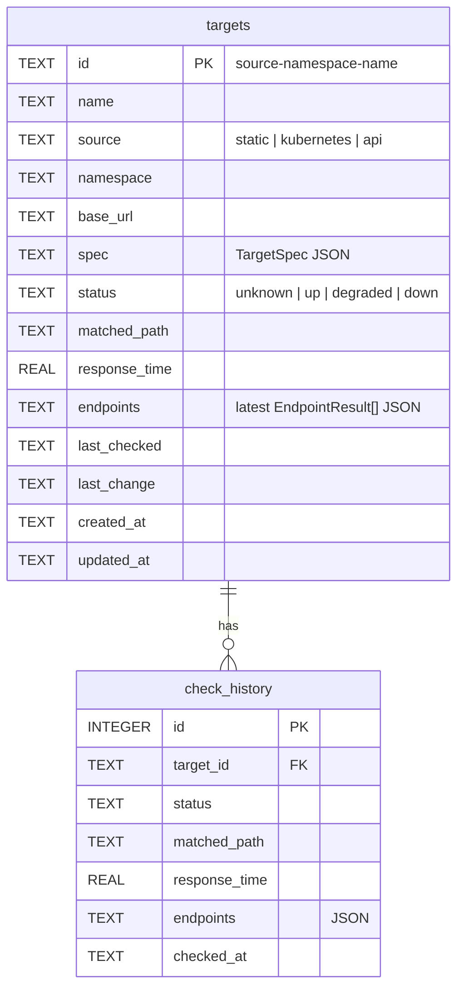

# Storage (SQLite)

Analogy: the **records cabinet**. We first try the main archive room; if it is locked we
use the storeroom; if that is locked too, we write on a clipboard that is thrown away at the
end of the day.



The backend in use is:

* logged at startup (`"message": "storage ready", "backend": "file|temp|memory"`);
* exposed in `GET /api/v1/summary` (`storage_backend`, `storage_location`);
* exported as the metric `myhealthcheck_storage_backend{backend="..."} 1`.

A corrupted database file also triggers the fallback (the file is left untouched for analysis).

## Schema



* `check_history` keeps the last `HISTORY_RETENTION` rows per target (older ones are pruned on insert).
* Deleting a target cascades to its history.
* `PRAGMA user_version` holds the schema version (`SCHEMA_VERSION` in `storage.py`); bump it and add
  a migration when the schema changes.
* WAL mode is enabled for file databases.

## Inspecting the database

```bash
sqlite3 data/myhealthcheck.db 'select name, status, last_checked from targets;'
docker compose exec myhealthcheck python -c \
  "import sqlite3; print(sqlite3.connect('/data/myhealthcheck.db').execute('select count(*) from check_history').fetchone())"
```

## Kubernetes

The chart mounts `/data` from an `emptyDir` (history lost when the pod is recreated) or,
with `persistence.enabled=true`, from a PVC (the Deployment then uses the `Recreate`
strategy so the ReadWriteOnce volume is never attached to two pods). `/tmp` is an `emptyDir`
too, so the temp fallback works with `readOnlyRootFilesystem: true`.
